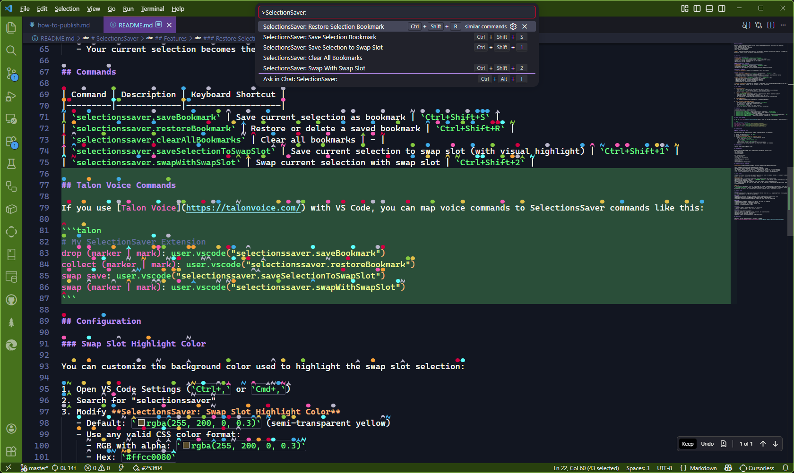

# SelectionsSaver

A Visual Studio Code extension that provides enhanced bookmark functionality by recording and restoring:
- Text selections in code files
- Line locations and cursor positions  
- Vertical scrollbar positions
- File context for navigation

**NEW**: Bookmarks are now workspace-specific! Each workspace maintains its own set of bookmarks, providing better organization and preventing bookmark clutter when working on multiple projects.

## Quick Preview

This screenshot shows the command palette entries and Talon voice mappings for fast onboarding:




## Features

### Save Selection Bookmarks
- **Command**: `SelectionsSaver: Save Selection Bookmark`
- **Shortcut**: `Ctrl+Shift+S` (Windows/Linux) / `Cmd+Shift+S` (Mac)
- Captures your current text selection, cursor position, and scroll location
- Allows you to provide an optional name for the bookmark
- If left blank, automatically generates a name from selected text when possible, otherwise uses a random verb+noun name
- Includes an optional checkbox-style toggle to clear all existing bookmarks before saving the new one
- Works across all code file types

### Restore Selection Bookmarks
- **Command**: `SelectionsSaver: Restore Selection Bookmark`
- **Shortcut**: `Ctrl+Shift+R` (Windows/Linux) / `Cmd+Shift+R` (Mac)
- Shows a quick pick list of all saved bookmarks
- Navigates to the saved file, restores the exact selection, and scroll position

### Bookmark Management
- **Clear All Bookmarks**: Remove all saved bookmarks (with confirmation)

### Swap Slot Feature
- **Save Selection to Swap Slot**: `Ctrl+Shift+1` (Windows/Linux) / `Cmd+Shift+1` (Mac)
  - Saves your current selection to a temporary swap slot
  - The saved selection is highlighted with a customizable color (default: semi-transparent yellow)
  - The highlight remains visible until you swap or save a new selection
  
- **Swap With Swap Slot**: `Ctrl+Shift+2` (Windows/Linux) / `Cmd+Shift+2` (Mac)
  - Exchanges your current selection with the swap slot selection
  - Navigates to the swap slot location and selects that text
  - Updates the swap slot to contain your previous selection
  - The new swap slot location is highlighted
  
- **Visual Highlighting**: The swap slot selection is highlighted with a customizable background color to make it easy to see where your saved selection is located. You can customize this color in settings.

## How to Use

1. **Save a Bookmark**:
   - Select some text or position your cursor where you want to bookmark
   - Press `Ctrl+Shift+S` or use Command Palette → "SelectionsSaver: Save Selection Bookmark"
   - Optionally enter a name for the bookmark
   - Leave the name blank to auto-generate one
   - (Optional) Tab to the "Clear all existing bookmarks before saving this one" checkbox and check it if you want to replace all prior bookmarks

2. **Restore or Delete a Bookmark**:
   - Press `Ctrl+Shift+R` or use Command Palette → "SelectionsSaver: Restore Selection Bookmark"
   - Select from the list of saved bookmarks to restore
   - To delete a bookmark, click the trash icon next to it in the list
   - The extension will open the file and restore your exact selection and scroll position

3. **Manage Bookmarks**:
   - Use Command Palette → "Clear All Bookmarks" to remove all bookmarks

4. **Use Swap Slot for Quick Navigation**:
   - Select text you want to save temporarily and press `Ctrl+Shift+1`
   - The selection will be highlighted with a visible color
   - Navigate elsewhere in your code
   - Press `Ctrl+Shift+2` to swap to the saved location
   - Your current selection becomes the new swap slot (also highlighted)

## Commands

| Command | Description | Keyboard Shortcut |
|---------|-------------|-------------------|
| `selectionssaver.saveBookmark` | Save current selection as bookmark | `Ctrl+Shift+S` |
| `selectionssaver.restoreBookmark` | Restore or delete a saved bookmark | `Ctrl+Shift+R` |
| `selectionssaver.clearAllBookmarks` | Clear all bookmarks | - |
| `selectionssaver.saveSelectionToSwapSlot` | Save current selection to swap slot (with visual highlight) | `Ctrl+Shift+1` |
| `selectionssaver.swapWithSwapSlot` | Swap current selection with swap slot | `Ctrl+Shift+2` |

## Talon Voice Commands

If you use [Talon Voice](https://talonvoice.com/) with VS Code, you can map voice commands to SelectionsSaver commands like this:

```talon
# My SelectionSaver Extension
drop (marker | mark): user.vscode("selectionssaver.saveBookmark")
collect (marker | mark): user.vscode("selectionssaver.restoreBookmark")
swap save: user.vscode("selectionssaver.saveSelectionToSwapSlot")
swap (marker | mark): user.vscode("selectionssaver.swapWithSwapSlot")
```

## Configuration

### Swap Slot Highlight Color

You can customize the background color used to highlight the swap slot selection:

1. Open VS Code Settings (`Ctrl+,` or `Cmd+,`)
2. Search for "selectionssaver"
3. Modify **SelectionsSaver: Swap Slot Highlight Color**
   - Default: `rgba(255, 200, 0, 0.3)` (semi-transparent yellow)
   - Use any valid CSS color format:
     - RGB with alpha: `rgba(255, 200, 0, 0.3)`
     - Hex: `#ffcc0080`
     - Named colors: `yellow`, `lightblue`, etc.
   - Adjust the alpha channel (last number) to control transparency
   - Choose colors that contrast well with your theme while keeping text readable

## Requirements

- Visual Studio Code 1.100.3 or higher

## Data Storage

Bookmarks are stored using VS Code's global state, meaning they persist across:
- VS Code restarts
- Workspace changes
- Extension updates

Each bookmark contains:
- Unique identifier
- Optional user-provided name
- File path
- Selection start/end positions
- Scroll position
- Timestamp
- Workspace folder (if applicable)

## Workspace-Specific Bookmarks

**Important**: Bookmarks are now scoped to individual workspaces for better organization:

- Each workspace maintains its own separate set of bookmarks
- Bookmarks are only visible when their corresponding workspace is open
- No workspace required error: You must have a workspace/folder open to save or restore bookmarks
- When switching between workspaces, you'll only see bookmarks relevant to the current workspace
- This prevents bookmark clutter and improves organization when working on multiple projects

## Known Issues

- Bookmarks reference static line and character positions. If lines are added or removed in a file after a bookmark is created, the bookmark may point to an incorrect or outdated location.

**Workarounds:**
- After major edits, re-save your bookmarks to ensure they point to the correct location.
- Place a unique comment or marker (e.g., `// BOOKMARK: MyFeature`) at the desired location. After editing, search for this marker and re-create the bookmark if needed.
- Avoid large-scale edits above bookmarked lines if you want to preserve bookmark accuracy.
- If a bookmark points to the wrong line after edits, use the extension to jump close to the old location, then manually adjust and re-save the bookmark.

**Note:**
It is technically possible to listen for file changes and attempt to update bookmarks automatically using the VS Code API (e.g., `onDidChangeTextDocument`). However, handling all possible text edits and keeping bookmarks accurate is complex and may impact performance. This feature may be considered for a future release if there is enough user interest.

## Release Notes

### 1.2.1
- Fixed: Bookmarks are no longer saved if you cancel the name input box (e.g., by pressing Esc or clicking away). The extension will only save a bookmark if you confirm the input box.

### 1.3.0
- Added auto-generated bookmark names when the name field is left blank:
  - Uses meaningful words from the current selection when available
  - Falls back to a random verb+noun name
- Added a checkbox in the save popup to optionally clear all existing bookmarks before saving the new one
- Added bookmark-name uniqueness handling by appending a suffix when needed

### 1.2.0
- Added ability to delete individual bookmarks directly from the restore picker (trash icon)
- Removed non-functional 'List Bookmarks' command and related UI/documentation
- Cleaned up documentation and improved user guidance for known issues and workarounds

### 1.1.0
- Added bookmark management commands: list, delete, and clear all bookmarks
- Implemented import/export of bookmark collections
- Improved error handling for missing or changed files
- Enhanced UI feedback and user prompts

### 1.0.1
- Fixed minor bugs in bookmark persistence and restoration
- Improved compatibility with recent VS Code versions

### 1.0.0
- Initial release of SelectionsSaver
- Save and restore text selections, cursor positions, and scroll locations
- Bookmarks persist across VS Code sessions
- Quick pick UI for restoring bookmarks
- Optional bookmark naming and workspace folder association

## Repository

The source code for SelectionsSaver is available on GitHub:
[https://github.com/Mark-Phillipson/selectionssaver](https://github.com/Mark-Phillipson/selectionssaver)
